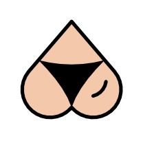

<p align="center">
  
</p>

<h1 align="center">ASSella</h1>

<p align="center">
  <strong>Steam depot download manager with extra goodies!</strong>
</p>

<p align="center">
  SLSsteam companion built on Qt for Linux and ARM64.
</p>

<p align="center">
  <a href="https://github.com/niwia/ASSella/releases"></a>
  <a href="https://github.com/niwia/ASSella/releases/latest"></a>
  <a href="https://github.com/niwia/ASSella/releases"></a>
  <a href="https://github.com/niwia/ASSella/releases"></a>
  <a href="https://github.com/niwia/ASSella/stargazers"></a>
  <a href="LICENSE"></a>
</p>

<p align="center">
  <a href="https://ko-fi.com/J5L022MXRU"></a>
</p>

<p align="center">
  <a href="https://assella.pages.dev/">Visit ASSella</a> &middot;
  <a href="https://assella.pages.dev/install">How to install</a> &middot;
  <a href="https://github.com/niwia/ASSella/projects">Roadmap</a> &middot;
  <a href="https://github.com/niwia/ASSella/releases">Releases</a>
</p>

---

### Quick Install

Install ASSella directly via Konsole / terminal:

```bash
curl -fsSL https://raw.githubusercontent.com/niwia/ASSella/main/install.sh | bash
```

> For step-by-step installation instructions, Steam Deck setup guides, and troubleshooting, visit the official documentation at **[assella.pages.dev](https://assella.pages.dev/)**.
